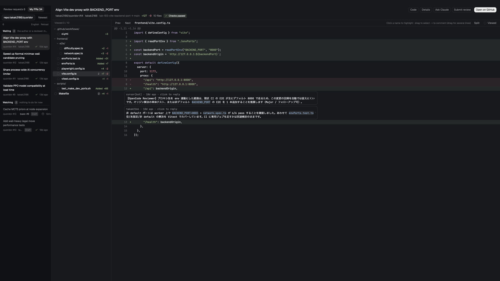

# herdr-pr-review

[Herdr](https://herdr.dev) で GitHub の Pull Request をレビューするためのレイアウトです。[English](README.md)

- 自分の PR とレビュー依頼を、次にやることで分けて並べる（レビューする・対応する・返事待ち・ウォッチ）
- 差分をフォルダの木からファイルごとに、シンタックスハイライト付きで読む（1 列・左右）。GitHub の Viewed の印も使える
- 行・複数行へのコメントと返信を手元で下書きして、まとめて 1 つのレビューとして送る
- PR の head のコードを開き、F12 で定義、Shift+F12 で参照（Go は gopls で型を見て調べ、gRPC のサービスをまたいだ呼び出しも出す）、行の blame、Ctrl+F で検索、文字の選択
- 右のペインで、その PR について Claude Code に聞く
- 日本語と英語（Mac の言語に合わせる。切り替えも可）



## 入れ方

Herdr のエージェントに次のように頼むと、手順（ファイルのコピーとキー設定のマージ）に沿って入れてくれます。

```
github.com/takak2166/herdr-pr-review のレイアウトを入れて
```

手で入れる場合は、`layouts/pr-review.json` と `mods/pr-review/` を `~/.config/herdr-app/` の同じ場所に写し、`keys.json` を自分の `keys.json` にマージしてから、`ctrl-shift-l`（または `layout.switch {name: "pr-review"}`）で切り替えます。

## 前提

- macOS
- `gh` にログイン済み（一覧・差分・Viewed の印・レビューの送信に使います）
- レビューするリポジトリのクローンが `~/ghq/github.com/<owner>/<repo>` にあること（コード表示・定義・参照・blame に使います。差分だけならなくても動きます）
- 任意: `gopls` と `go`（Go の参照を型で調べます。なければ単語の検索になります）
- 右のペインには `claude`（Claude Code）

## キー

| キー | 動き |
|---|---|
| F12 | ハイライトした名前の定義へ |
| Shift+F12 | 参照へ（もう一度で次へ） |
| Ctrl+- / Ctrl+Shift+- | 戻る / 進む |
| Cmd+Shift+C | コードと差分を切り替え |
| Ctrl+F | 表示中のファイルを検索 |
| Cmd+C | 選んだ文字をコピー |

## 自分のタブと質問

`~/.config/herdr-app/data/pr-review/config.json` に書きます（[config.example.json](config.example.json) を参照）。

```json
{
  "tabs": [{ "name": "チーム", "query": "repo:owner/name" }],
  "prompts": [{ "label": "セキュリティ", "ask": "この PR のセキュリティ上の問題を探してください。" }]
}
```

タブの query は GitHub の検索条件です（`is:pr is:open` が付きます）。prompts を書くと、最初から入っている 2 つの質問（レビューして・図解して）の代わりになります。書き換えたら `pr-review.config` を実行するか、Herdr を起動し直してください。

## 一覧の絞り込み

絞り込みの欄は、題・番号・リポジトリ・作者で探します。`review:required` / `approved` / `changes`、`is:draft`、`ci:failing` / `passing`、`author:<名前>`、`repo:<名前>` も使えます。

作りの詳細は [RECIPE.md](RECIPE.md)（英語）にあります。
