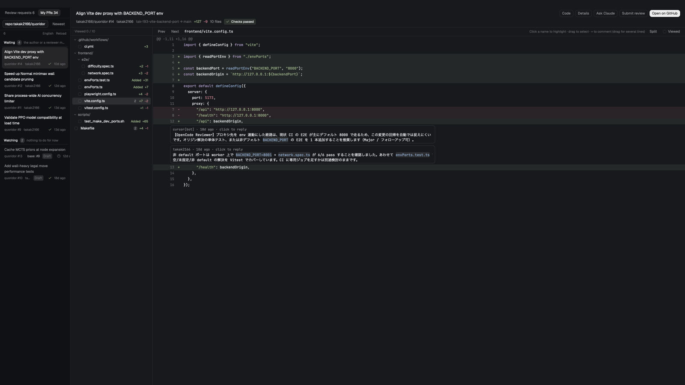

# herdr-pr-review

A [Herdr](https://herdr.dev) layout for reviewing GitHub pull requests. [日本語](README.ja.md)

- Your pull requests and review requests, grouped by what to do next: To review, To fix, Waiting, Watching
- The diff file by file, from a folder tree, with syntax colors (unified or split), and GitHub's Viewed marks
- Line and multi-line comments and replies, drafted locally and submitted as one review
- A code view of the head commit: go to definition (F12), find uses (Shift+F12; for Go by type with gopls, across gRPC services), blame of the current line, search (Ctrl+F), text selection
- Ask Claude Code about the pull request in a pane on the right
- English and Japanese (follows the Mac's language; switchable)



## Install

Ask Herdr's agent:

```
Add the layout from github.com/takak2166/herdr-pr-review
```

It copies the files and merges the keys as Herdr's guide says. By hand: copy `layouts/pr-review.json` and `mods/pr-review/` to the same places under `~/.config/herdr-app/`, merge `keys.json` into yours, then switch with `ctrl-shift-l` (or `layout.switch {name: "pr-review"}`).

## Requirements

- macOS
- `gh`, logged in (lists, diffs, Viewed marks and reviews go through it)
- A clone of each repository at `~/ghq/github.com/<owner>/<repo>` for the code view, definitions, uses and blame (the diff works without one)
- Optional: `gopls` and `go`, to find Go uses by type (a word search is used otherwise)
- `claude` (Claude Code) for the right pane

## Keys

| Key | Does |
|---|---|
| F12 | Go to the highlighted name's definition |
| Shift+F12 | Go to its uses (again: the next one) |
| Ctrl+- / Ctrl+Shift+- | Back / forward |
| Cmd+Shift+C | Switch between the code and the diff |
| Ctrl+F | Search the file shown |
| Cmd+C | Copy the selected text |

## Your own tabs and questions

`~/.config/herdr-app/data/pr-review/config.json` (see [config.example.json](config.example.json)):

```json
{
  "tabs": [{ "name": "Team", "query": "repo:owner/name" }],
  "prompts": [{ "label": "Security", "ask": "Look for security problems in this pull request." }]
}
```

A tab's query is a GitHub search (`is:pr is:open` is added). Your prompts replace the two built-in questions (Review, Diagram). Run `pr-review.config` (or restart) after editing.

## Filtering the list

The filter box matches title, number, repository and author, and understands `review:required` / `approved` / `changes`, `is:draft`, `ci:failing` / `passing`, `author:<login>`, `repo:<name>`.

How it is built: [RECIPE.md](RECIPE.md).
