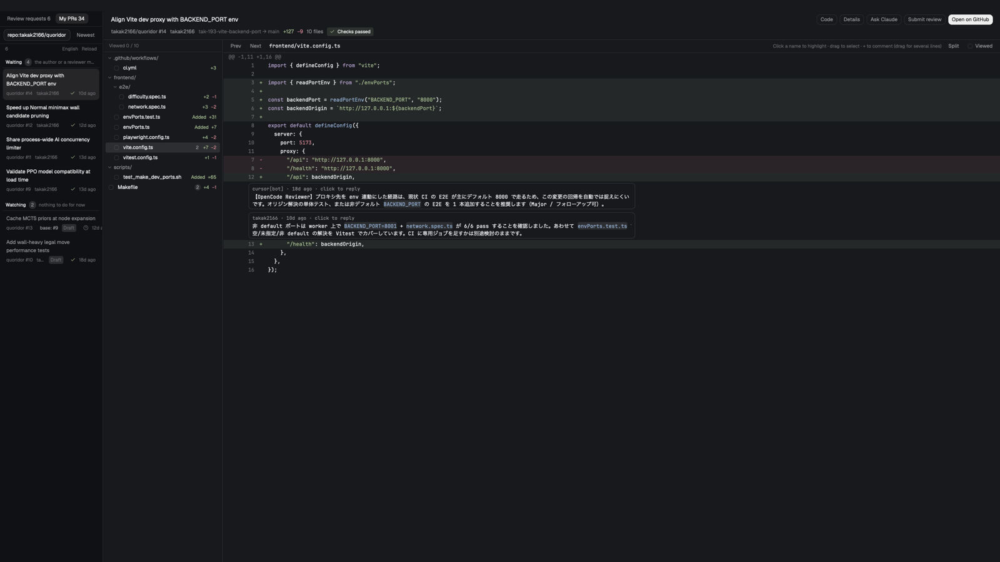

# PR Review

A whole window for reviewing GitHub pull requests without leaving Herdr. Your review requests and
your own pull requests are grouped by what to do next; one pull request's diff is read file by
file from a folder tree, with syntax colors and GitHub's Viewed marks; line comments and replies are
drafted locally and submitted as one review, resolved threads folded until clicked; a code view of the head commit has go to definition
(F12), find uses (Shift+F12; for Go by type through gopls, and across gRPC services), blame of the
current line, search (Cmd+F) and text selection, and a second column with another file (Cmd+click); and a Claude Code session about the pull request
opens in a pane on the right. In English or Japanese.



## What you see

Left to right, all in the theme's colors (`canvas` behind, `surface` cards, `chrome` bars), 12px
UI text, the terminal font for code. Radii 4 / 8, a 4px grid, line icons.

1. **The list** (360px; 160–640, drag its edge, double-click for 360). Tabs `Review requests`
   (`review-requested:@me`) and `My PRs` (`author:@me`), then any from `config.json`, each with its
   count. A filter box (hint drawn behind it while empty) and the order within groups (`Updated`,
   `Newest`, `Oldest`). A line: count, `Show/Hide N by bots`, the language switch, `Reload`.
   The list is always split into four groups, each under a heading (bold name, a count pill, a dim
   hint): **To review** (waiting for your review), **To fix** (your pull requests, your move),
   **Waiting** (the author or a reviewer moves next), **Watching** (nothing to do for now).
   A row: the title (wrapped), `repo #n`, author, `base: #n` when it builds on another open pull
   request, `Draft`, a pencil when you have drafts, review decision, checks icon, age. A pull request
   whose base is in the same group sits right under it, set in 16px with a corner icon.
2. **The pull request's bar**: title, `owner/repo #n`, author, `head → base`, `+add −del`, file
   count, status tags (dot or icon + word: Draft, Approved / Changes requested / Review required,
   checks). Buttons `Code`, `Details`, `Ask Claude`, `Submit review` (with the draft count),
   `Open on GitHub` (solid). `Ask Claude` opens a row of question chips and an input.
3. **The files** (250px; 160–560): `Viewed N / M` over a tree. Folders (chevron, `name/`, folded by
   a click; a folder holding one folder is joined with it), then files: a Viewed checkbox, the name,
   `Added` / `Deleted` / `Renamed`, the count of comments on it, a pencil, `+add −del`. Generated files
   (generated code, lock files, API descriptions, snapshots, mocks) last under `Generated`, dimmed,
   by their whole path.
4. **The diff**, one file at a time. A bar: `Prev` / `Next`, the path, tags, a hint or the marked
   name with its count and ‹ › ×, `Split` / `Unified` (a file with one side is always unified),
   `Viewed`. Rows 20px: [+ 20][line number 40][mark 8] then the code; split, each half wraps. Added
   lines `ansi2` at 9% behind, removed `ansi1`. Comments as cards under their line (author, age,
   limited Markdown: quotes, code, bold, headings, lists, shields badges); drafts in the accent color.
   The composer opens at the foot.
5. **The side pane** (400px; 280–800) for `Details` or `Submit review`.
6. **The Claude pane** on the right (560px; 360–1100, hidden until asked): a bar of the pull
   requests' Claude tabs and the tab's terminal.

## How it behaves

- **Language**: Japanese when the Mac's first preferred language is Japanese
  (`defaults read -g AppleLanguages`), else English; the switch at the list's foot cycles
  日本語 → English → Mac, kept in the mod's localStorage (`lang-ja` / `lang-en` / `lang-auto` too).
- **Lists** load every 5 minutes and on `Reload`; a 502 from GitHub's search is retried once.
- **Groups** come from rules: your draft → Watching; your pull request with failing checks, changes
  requested or approved → To fix, else Waiting; a review request → To review (Watching for a draft or
  a bot, Waiting when checks fail); you reviewed and it was pushed since → To review, else Waiting;
  anything else → Watching.
- **Filter** narrows what is loaded (no GitHub search): words match title, number, repository and
  author; `review:required|approved|changes`, `is:draft`, `ci:failing|passing`, `author:`, `repo:`.
- **Diff**: hover a line and its `+` shows; click it to comment; drag from a `+` across lines of the
  same side and hunk for a multi-line comment (Shift-click widens too). Click a name to mark every
  whole use of it. Drag over text to select it (I-beam pointer); Cmd+C or the bar's `Copy`.
- **Viewed** is GitHub's own mark (`viewerViewedState`, `markFileAsViewed` / `unmarkFileAsViewed`),
  read when the pull request opens; marking the shown file goes on to the next one not viewed.
  The mark shows at once and is taken back if GitHub refuses it.
- **Comments**: drafts are kept per pull request in localStorage until sent. In the comment box
  Enter starts a new line (the editor does that itself and also emits `submit`), and only a `submit`
  with `secondary` (Cmd+Enter) saves the draft. Resolved threads
  (`isResolved` from GraphQL) are folded to one `Resolved` row; a click opens or folds them again
  (one with a draft reply stays open), in the diff and in the preview's column. Labels `ask` / `imo` /
  `nits` / `tsubuyaki` insert a shields.io badge. `Submit review` sends one review (Comment or
  Approve) after a second press; with replies it builds a pending review, adds the replies, then
  submits it (deleting the pending review if a step fails).
- **Code view** (`Code`, Cmd+Shift+C at the same line): F12 goes to the marked name's definition
  (several candidates listed above); for Go, gopls answers by type first and the word search of `git grep -p` (a function's own variables left out) is the fallback. Shift+F12 lists the uses at once by word (strings and comments
  left out), then for Go replaces them with gopls' answer by type; when the name is an RPC
  (`rpc Name(` in `proto/src/<svc>/`), the calls through that service's generated gRPC client from
  other services (`gRPC ← <service>`) and the server method they land in (`impl`) are added. Pressing
  again goes to the next use. Ctrl+- / Ctrl+Shift+- go back and forward, to the diff too. The current
  line shows its last change (author, age, `this PR`, summary; click opens the commit). Cmd+F (or
  Ctrl+F) searches the file shown, Enter / Shift+Enter, Esc. Jumps put the line in the middle.
  Cmd+click a file in the tree opens it in a second column on the right (an `x` in its header closes
  it). Each column keeps its own file, history, mark, selection and search; F12 and Shift+F12 open
  in the column where they were pressed.
- **Preview** (Markdown files only; `Preview` in the file bar, or the command `pr-review.preview`):
  the file at the head commit, drawn block by block (headings, paragraphs, list items with their
  nesting, tables, quotes, code fences, front matter as YAML). Pressing a block opens the comment box
  on its lines: all of them when they are one stretch of one hunk, else the first line in the diff;
  a block outside the diff says it can't take a comment. Drafts and GitHub's threads on the file show
  as a count on their block (orange with a thread, gray for drafts only) and in a column on the right
  (`Reply` on threads, `Edit` on drafts). `pr-review.preview-line-<n>` presses the block holding line n.
- **Mermaid** in the preview: each ```` ```mermaid ```` block is laid out by Mermaid in headless Chrome
  and shown as SVG on white, shrunk to fit; code and a reason show while it draws or when it fails.
  A click on the diagram enlarges it over the preview at 1x to 4x (sizes that would exceed 3600px
  are not offered), dragged or scrolled about and kept 24px inside the edges; `この図にコメント`
  picks its block, `閉じる` closes it.
- **Ask Claude**: the question chips (`Review`, `Diagram`, or yours from `config.json`) and an input.
  The first question opens a tab `<repo>#<n> review` running `claude` in the clone (read-only
  instructions in the first message) and shows the right pane; with a session already there, the pane
  opens on it and the question is sent into it (`hc send`, which waits for an unsent draft).
- **Research** (`下調べ` in the header, or `pr-review.research`): Claude Code (`claude -p`, Read / Grep /
  Glob only, model and effort from `config.json`'s `research`, default `opus` / `high`) reads the head
  commit's files with the description and the diff, and answers in a JSON schema: findings of kind
  `mismatch` (code against the description, a design document or ADR, or other code) or `unexplained`
  (a choice whose reason is in no comment and not in the description), each with a `severity`
  (`must`: behaves wrongly once merged, even when it looks like a missing reason; `should`: disagrees
  with what is written or leaves a reader to guess; `nit`: nothing goes wrong if it stays), `path`,
  `line`, `title`, `points`, `sources` and a draft `comment`. Findings on lines the diff doesn't show
  are left out; the rest are kept most severe first. Each shows under its line as a box headed
  `下調べ · must · 食い違い`, red for must, blue for should, gray for nits (by kind, red for mismatch
  and blue for unexplained, in research from before severities), with its grounds; nits start folded;
  a click opens the comment box with the draft (on your own pull request a note of what to explain,
  otherwise a question, starting with the nits badge for a nit), where `対応不要` dismisses it. A finding with a draft made from it, or
  dismissed, folds to one row (deleting the draft brings it back). The button reads `下調べ n/m`
  (handled / all), led by the musts not yet handled (`下調べ must 2 · 0/7`): a press shows or hides the findings, Shift+press asks again. The answer is kept
  per head commit in `data/pr-review/research/`, with the models that answered.
  `コピー` on a box (only where rows can hold controls: files of up to 1500 rows), `下調べをコピー` in
  the comment box opened from one, and `全部コピー` in the header copy findings as text, most severe
  first: `path:line [severity · kind] title`, its points, its grounds; all of them start with the
  pull request.
- **Slack links** (optional): `data/pr-review/slack-threads.jsonl`, lines of
  `{"pr": "<url>", "thread": "<slack url>"}`, puts a Slack icon and button on those pull requests.

## Built from

- `layouts/pr-review.json`: a row `root` with `review-main` (block, `mod: pr-review`, min 600,
  `canvas`) and `review-chat` (column, hidden, 560px): `review-chat-head` (34px, `mod: pr-review`,
  `props.role: "chat-head"`) over `review-chat-tab` (`tab: active`).
- `mods/pr-review/`: `main.js` (the view; roles `main` and `chat-head`), `i18n.js` (`L(ja, en)` and
  the Mac's language), `github.js` (`gh`: GraphQL search, `gh pr view` / `diff` with a per-file
  fallback for very large pull requests, review comments, Viewed marks, `submitReview`), `diff.js`
  (unified diff → rows; quoted and non-ASCII paths; tree order, generated files last), `highlight.js`
  (a small per-language tokenizer), `code.js` (files, definitions, uses, blame from the local clone
  with `git show` / `git grep` / `git blame`), `tree.sh` (the head commit taken out of the clone's
  git objects into a cache folder, the five most recent kept), `research.js` and `research.sh` (the research: the
  request, the schema, `claude -p` in the head commit's files), `gopls-refs.sh` (gopls on that copy of the
  commit: definitions and uses, plus the gRPC bridge), `lsp/main.go` (gopls-lsp: a small server, standard
  library only, that keeps up to three LSP sessions open through the shared gopls daemon and exits
  after 30 idle minutes), `preview.js` (the Markdown preview: blocks with their lines, the
  comment column, Mermaid and the enlarged view), `render-mermaid.mjs` (Node: starts Chrome headless
  with a throwaway profile, drives it over the DevTools protocol, writes `<key>.svg` and `<key>.json`).
- `data/pr-review/mermaid/mermaid.min.js` (not in the repository; installed from npm) and
  `data/pr-review/mermaid/cache/` for drawn diagrams.
- herdr: `exec`, `hc`, `run` (`layout.show` / `layout.hide`, `tab.new`, `tab.select`, `tab.close`),
  `spaces`, `panes`, `theme`, `settings` (font and zoom), `notify`, `nextCommand`, `appHome`,
  `readTextFile`, `home`.
- `keys.json`: the section `layout:pr-review` and terminal pass-through for the same keys.
- `data/pr-review/config.json` (optional): `tabs`, `prompts` and `research` (`model`, `effort`).
- `data/pr-review/research/`: the research kept per pull request and head commit.
- Programs: `gh` (logged in), `git`, `defaults`, optionally `gopls` and `go`, `claude`, and for
  Mermaid `node` (22+, for its WebSocket) and Google Chrome.

## Watch out

- Pointer positions arrive in window pixels scaled by the person's zoom: divide by
  `settings().zoom` before comparing with layout sizes (text columns, the `+` hit area).
- An input's placeholder can't change after it is made: draw the hint behind an empty input instead,
  so it follows the language.
- Virtual list rows take no handlers and repaint on hover only when the list re-renders: files up to
  1500 rows are drawn whole (per-row hover, drag, selection); longer ones use a virtual list without
  selection and with the `+` shown only near the gutter. A handler on anything inside a
  row (the blame tag too) makes the whole list draw nothing: draw plain text there.
- `TextEncoder` does not exist in this runtime: decode git's octal-quoted paths via percent-encoding
  and `decodeURIComponent`.
- Cut lines over 1000 columns before untabbing; minified files otherwise stall the regex.
- An exception in the command loop ends it silently: catch per command and notify. Two methods with
  one name in a class: the later wins without a word.
- Mermaid puts labels in HTML (`foreignObject`), which Herdr's SVG renderer doesn't draw: turn
  `htmlLabels` off (top level and `flowchart`) so labels are SVG text, and name a Japanese font.
- Mermaid fits a diagram to the page's width: set the SVG's width and height from its viewBox.
- Herdr keeps an image it loaded by its path: a change in how diagrams are drawn needs new file
  names (a version in the key). An image is one GPU texture: very large ones break, so cap the zoom.
- An image in a flex column stretches: give its box an explicit width and height.
- Sizes from `on_size_change` are zoomed as pointer positions are: divide them too.
- The app's PATH may lack Go's tools: `gopls-refs.sh` borrows the login shell's PATH. So does `research.sh`, for
  `claude`.
- The research is costly: at high effort, a run on a large repository read for about four minutes
  and took a large share of a Claude session's usage. It runs only when asked, and its answer is kept.
- `claude -p --json-schema` puts the answer in `structured_output`; `modelUsage` names the models.
  The extracted tree is not a trusted workspace, so Claude Code ignores the repository's own
  `.claude/settings.json` permissions there (only reading tools are given anyway).
- A finding's box is a row of the diff list: like comments, it is wrapped ahead of time and pressing
  it goes through `pressRow`.
- Assumes macOS (`defaults`, `dscl`, `~/Library/Caches/herdr-pr-review` for gopls trees) and clones
  at `~/ghq/github.com/<owner>/<repo>`. gopls trees are whole checkouts (the five most recent kept);
  one `gopls serve` keeps running on a socket in the cache folder, and gopls-lsp is built into
  `bin/gopls-lsp-<hash>` there with `go build` (again when its source changes). A unix socket path
  may be at most 104 bytes on macOS: keep the cache folder's path short.

## Done when

- The layout loads with no `layout.error`, `herdr-app check mods/pr-review` passes.
- `Review requests` lists the pull requests requesting your review under the four group headings;
  a click shows the files as a tree and the first file not viewed.
- The language switch turns every label between English and Japanese.
- Marking a file Viewed shows as Viewed on GitHub's page; the next file opens.
- Hovering a diff line shows its `+`; a drag from a `+` across lines opens a range comment.
- A draft sent with `Submit review` appears on GitHub as one review.
- F12 on a marked name opens its definition; Ctrl+- comes back to the diff.
- Shift+F12 on a Go RPC handler lists the calls from other services with `gRPC ←`.
- Cmd+F marks matches and Enter steps through them.
- F12 on `u.x()` in Go opens the method of `u`'s type, not another `x` of the same name.
- Cmd+click on a file in the code view shows it in a second column; F12 there stays in that column.
- A resolved thread shows as one `Resolved` row; a click opens it.
- `下調べ` on a pull request shows findings under lines of the diff and `下調べ 0/n` in the header;
  a click on one opens the comment box with its draft, and saving folds it (`下調べ 1/n`).
- `全部コピー` puts every finding on the clipboard, each starting with its `path:line`, musts first.
- A `nit` finding shows as one folded row; a `must` one is red and counted in the header button.
- `Ask Claude` → `Review` opens a `… review` tab in the right pane.
